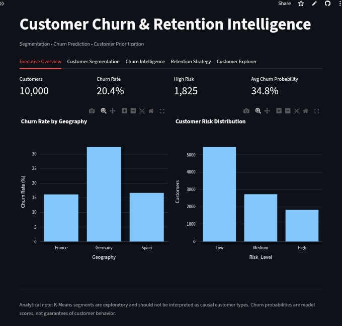
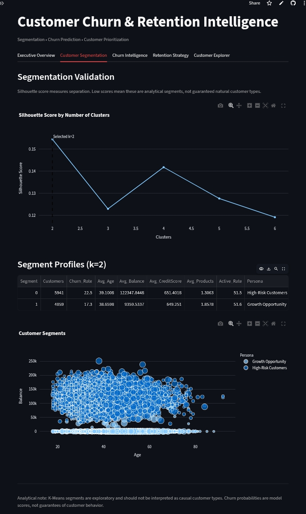
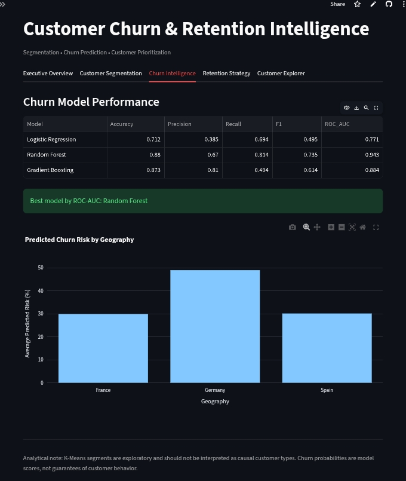
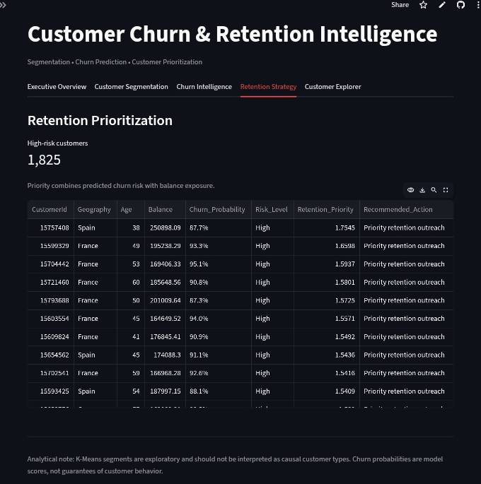

# Customer Churn & Retention Intelligence

> An end-to-end customer analytics and machine learning application that identifies churn risk, segments customers, and converts predictive insights into actionable retention priorities.

[](https://customer-churn-retention-intelligence-rtmjld9xsqh5bxxr5bdqqj.streamlit.app/)
[](https://github.com/Jahnavi06in/customer-churn-retention-intelligence)

---

## 🚀 Live Dashboard

### [Open the Customer Churn & Retention Intelligence Dashboard](https://customer-churn-retention-intelligence-rtmjld9xsqh5bxxr5bdqqj.streamlit.app/)

An interactive Streamlit decision-support application covering:

- 📊 Executive Overview
- 👥 Customer Segmentation
- 🤖 Churn Intelligence
- ⚠️ Customer Risk Analysis
- 🎯 Retention Strategy
- 🔎 Customer Explorer

> Streamlit Community Cloud apps sleep after inactivity. If you see a wake-up screen, click the button and wait a few seconds.

---

## 📌 Key Findings

- **20.4% of 10,000 customers churned.** Germany is the outlier at roughly 32%, about double France and Spain (~16%).
- **Random Forest was the best model** with ROC-AUC 0.943, recall 0.814 and precision 0.67.
- **1,825 customers (18%) are flagged High Risk**, and the retention list ranks them by churn probability weighted by account balance.
- **Segmentation is exploratory.** Silhouette scores stay low (max ≈ 0.15 at k=2), so the segments are analytical groupings, not natural customer types.

---

## 🎯 Business Problem

Customer churn is not only a prediction problem. Businesses also need to understand:

- Which customers are most likely to churn?
- Which customer groups are exposed to higher risk?
- How strong is the predictive model?
- Which customers should the retention team prioritize?
- How can analytical predictions be translated into business actions?

This project addresses these questions through **customer segmentation, supervised machine learning, risk scoring, and retention prioritization**.

---

## 🧩 Solution Architecture

```text
Churn_Modelling.csv
        │
        ▼
Data Validation & Exploration
        │
        ├──────────────────────┐
        │                      │
        ▼                      ▼
Customer Segmentation    Churn Prediction
        │                      │
        ▼                      ▼
Segment Profiles         Model Evaluation
                               │
                               ▼
                        Churn Probability
                               │
                               ▼
                         Risk Scoring
                               │
                               ▼
                    Retention Prioritization
                               │
                               ▼
                    Streamlit Decision App
```

---

## 📂 Dataset

- **Source:** Churn Modelling dataset (Kaggle), a bank customer dataset
- **Size:** 10,000 customers
- **Target:** `Exited` (1 = churned), overall churn rate 20.4%
- **Features:** CreditScore, Geography, Gender, Age, Tenure, Balance, NumOfProducts, HasCrCard, IsActiveMember, EstimatedSalary
- **Identifiers** (CustomerId, Surname) are used for display only, not for modeling

---

## 🔬 Methodology

### 1. Customer Segmentation
- K-Means evaluated for k = 2 to 6 using silhouette score (k = 2 selected, score ≈ 0.154)
- Features: CreditScore, Age, Tenure, Balance, NumOfProducts, EstimatedSalary, Geography, Gender
- Numeric variables standardized, categorical variables one-hot encoded
- Profiles built per segment: size, churn rate, average age, balance, credit score, products and activity

| Segment | Customers | Churn Rate | Avg Balance | Avg Products | Persona |
|---|---|---|---|---|---|
| 0 | 5,941 | 22.5% | 122,348 | 1.31 | High-Risk Customers |
| 1 | 4,059 | 17.3% | 9,360 | 1.86 | Growth Opportunity |

Segments are mostly separated by account balance. The churn gap between them is modest, so personas should be read as descriptive labels.

### 2. Churn Prediction
Three models were compared:

| Model | Accuracy | Precision | Recall | F1 | ROC-AUC |
|---|---|---|---|---|---|
| Logistic Regression | 0.712 | 0.385 | 0.694 | 0.495 | 0.771 |
| **Random Forest** | **0.880** | **0.670** | **0.814** | **0.735** | **0.943** |
| Gradient Boosting | 0.873 | 0.810 | 0.494 | 0.614 | 0.884 |

Random Forest was selected by ROC-AUC. Gradient Boosting has the highest precision but misses about half of churners, which matters when the cost of losing a customer is high.

### 3. Risk Scoring & Retention Prioritization
- The model's churn probability is mapped to risk tiers: **Low (<30%)**, **Medium (30–60%)**, **High (>60%)**; 1,825 customers fall in High
- These thresholds are business rules and should be recalibrated using historical retention campaign outcomes in production
- **Retention Priority** combines predicted churn probability with balance exposure, so high-value, high-risk customers surface first
- Each High-risk customer gets a recommended action (e.g. *Priority retention outreach*)

---

## 📊 Dashboard Tour

| Tab | What it shows |
|---|---|
| Executive Overview | KPIs (customers, churn rate, high-risk count, average churn probability), churn by geography, risk distribution |
| Customer Segmentation | Silhouette validation, segment profiles, balance vs. age scatter |
| Churn Intelligence | Model comparison table, predicted churn risk by geography |
| Retention Strategy | Ranked list of high-risk customers with recommended actions |
| Customer Explorer | Searchable customer-level table with persona and churn probability |







---

## 🛠️ Tech Stack

Python · pandas · NumPy · scikit-learn · Plotly · Streamlit

---

## ▶️ Run Locally

```bash
git clone https://github.com/Jahnavi06in/customer-churn-retention-intelligence.git
cd customer-churn-retention-intelligence
python -m venv .venv
source .venv/bin/activate        # Windows: .venv\Scripts\Activate.ps1
pip install -r requirements.txt
```

Place the dataset at `data/Churn_Modelling.csv`, then run:

```bash
streamlit run app.py
```

---

## 🗂️ Project Structure

```text
├── app.py                  # Streamlit entry point
├── app/
│   └── dashboard.py        # Dashboard tabs and layout
├── src/
│   ├── data.py             # Loading and validation
│   ├── segmentation.py     # K-Means and silhouette analysis
│   └── churn_model.py      # Model training, evaluation, risk scoring
├── data/                   # Dataset (see data/README.md)
├── models/
├── requirements.txt
└── README.md
```

---

## ⚠️ Limitations & Next Steps

- **Validation:** Report all metrics on a held-out test set and add cross-validation. Confirm that the churn probabilities shown in the app are not in-sample predictions.
- **Calibration:** Average predicted churn (34.8%) is higher than the observed rate (20.4%), so probabilities behave as risk scores rather than true likelihoods. Calibrate them (e.g. isotonic or Platt) before quoting them as percentages.
- **Weak clusters:** Silhouette ≈ 0.15 indicates overlapping segments. Try other features, algorithms or k values.
- **Retention cost:** The priority score does not include intervention cost or expected uplift. Next step: expected-value targeting.
- **Static data:** The dataset is a single snapshot with no time dimension, so there is no drift monitoring or churn-timing analysis.
- Churn probabilities are model scores, not guarantees of customer behavior.
